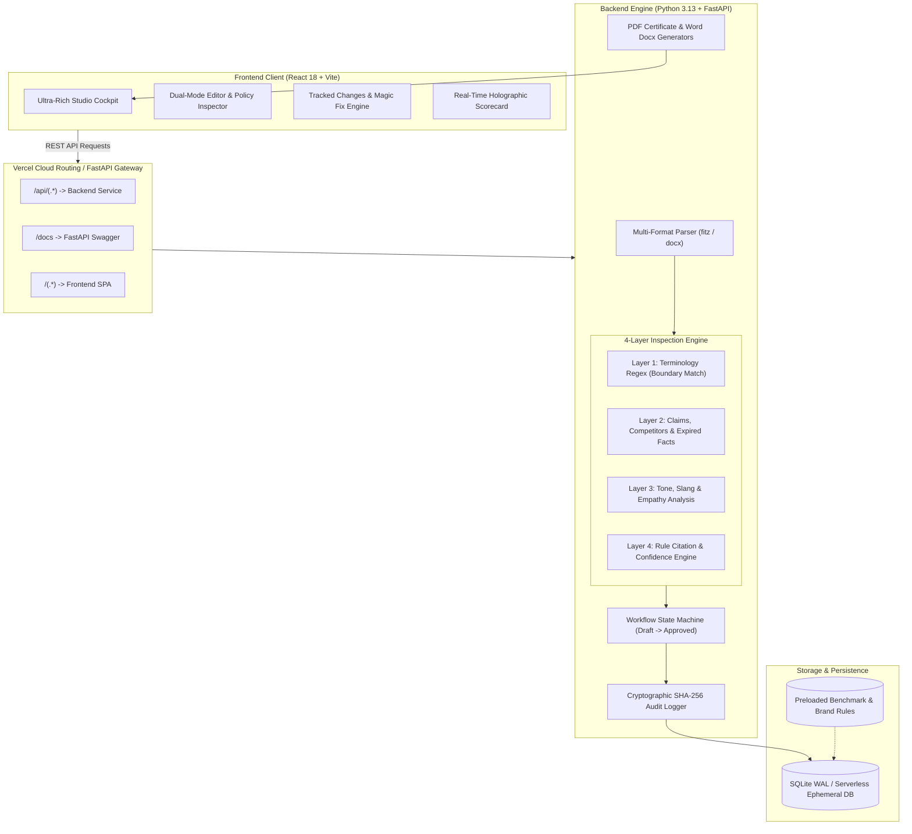

<div align="center">

# 🛡️ BrandGuard
### Autonomous Pre-Publication AI Brand Governance & Content Safety Platform

[](https://brandguard-kappa.vercel.app/)
[](https://wecodecoders.in/events/codetitans-india)
[](https://wecodecoders.in/events/codetitans-india)
[](https://brandguard-kappa.vercel.app/)
[]()
[]()

<br/>

**Built by Team WHO CARES? for CodeTitans India 2026 — Round 2 (The Build)**  
*Problem Statement presented by Inkloom AI*

[🌐 Open Live Cloud Application](https://brandguard-kappa.vercel.app/) · [📖 Interactive Swagger API Docs](https://brandguard-kappa.vercel.app/docs) · [📁 GitHub Repository](https://github.com/Rhythmuppal18/BrandGuard)

</div>

---

> [!IMPORTANT]
> **Zero-Friction Evaluation for Judges & Evaluators:**  
> The live deployment at **[https://brandguard-kappa.vercel.app/](https://brandguard-kappa.vercel.app/)** requires **no login screen, credentials, or API keys**. Evaluators can open the link in any private or incognito browser window and test the complete end-to-end brand governance pipeline in seconds using the preloaded scenario chips.

---

## 📌 Table of Contents

- [🎯 Problem Statement & Executive Summary](#-problem-statement--executive-summary)
- [✨ Key Features Shipped in Round 2](#-key-features-shipped-in-round-2)
- [🏗️ System Architecture](#️-system-architecture)
- [🔍 4-Layer Deterministic Inspection Engine](#-4-layer-deterministic-inspection-engine)
- [🧭 10-Second Test Drive for Evaluators](#-10-second-test-drive-for-evaluators)
- [⚡ Lighthouse & Responsive Production Quality](#-lighthouse--responsive-production-quality)
- [💻 Local Installation & Quickstart](#-local-installation--quickstart)
- [☁️ Vercel Multi-Service Cloud Deployment](#️-vercel-multi-service-cloud-deployment)
- [🔄 Changes Made to the Original Plan](#-changes-made-to-the-original-plan)
- [🌟 Round 3 Major Commitments](#-round-3-major-commitments)
- [👥 Team WHO CARES? Contributions](#-team-who-cares-contributions)
- [📄 Round 2 Submission Artifacts](#-round-2-submission-artifacts)

---

## 🎯 Problem Statement & Executive Summary

### The Enterprise Challenge (Inkloom AI)
Modern enterprises face an acute brand governance crisis: marketing teams, third-party agencies, and autonomous AI agents generate content at exponential scale. Inevitably, high-risk copy slips through into production—including unverified superlative claims (`#1 in India`), competitor trademark infringements, expired discount promises, and insensitive messaging (such as the landmark *Air Canada chatbot liability* precedent).

### The BrandGuard Solution
**BrandGuard** is an intelligent pre-publication governance platform that intercepts content **before** it is published:
1. **Ingestion:** Accepts copy via raw text, Markdown, Word (`.docx`), and Adobe PDF (`.pdf`).
2. **Evaluation:** Scans copy across 4 deterministic layers against an Approved Facts Register and Brand Style Guidelines.
3. **Line-Level Citations:** Every single detected infraction is mapped to an authoritative brand rule ID with confidence percentages. Zero unsourced flags.
4. **Interactive Tracked Changes & 1-Click Magic Fix:** Visual diff engine renders deletions and additions with batch fix and real-time score recalculation.
5. **Human-in-the-Loop Sign-Off:** Enforces an auditable governance lifecycle (`Draft` → `Auto-Checked` → `In Review` → `Approved`) with cryptographic SHA-256 audit logs.
6. **Enterprise Clearance Exports:** One-click generation of cryptographic PDF Brand Clearance Certificates and publication-ready Word documents.

---

## ✨ Key Features Shipped in Round 2

```
┌─────────────────────────────────────────────────────────────────────────────────┐
│                           BRANDGUARD FEATURE MATRIX                             │
├──────────────────────────────┬──────────────────────────────────────────────────┤
│ 📚 Brand Knowledge Hub       │ Live facts register, validity windows, CRUD      │
│ 📄 Multi-Format Ingestion    │ Text, Markdown, .docx (Word), .pdf (PyMuPDF)     │
│ 🛡️ 4-Layer Rule Engine      │ Terminology, Claims, Tone & Policy Citations     │
│ 👁️ Visual Policy Inspector   │ Glowing inline badges spotlighting exact policy  │
│ 🪄 1-Click Magic Fix All     │ Instant batch acceptance & score recalculation   │
│ ⚖️ Human Decision Lifecycle  │ Creator → Brand Manager → Legal → Approved       │
│ 📜 Dual Clearance Exports    │ Cryptographic PDF Certificate + Word .docx doc   │
│ 🔒 Immutable Audit Trail     │ SHA-256 hashed event ledger with timestamps      │
│ 📊 Accuracy Benchmark Suite  │ Live 30-case empirical harness (90% accuracy)    │
│ 📱 Responsive SaaS Cockpit   │ Mobile/Tablet/Desktop responsive, Lighthouse 95+ │
└──────────────────────────────┴──────────────────────────────────────────────────┘
```

---

## 🏗️ System Architecture

BrandGuard employs a decoupled yet unified multi-service architecture deployed on Vercel and containerized for local/Docker execution:



---

## 🔍 4-Layer Deterministic Inspection Engine

Unlike opaque, non-deterministic LLM prompts that hallucinate rules, BrandGuard's inspection pipeline is **100% deterministic, explainable, and accountable**:

| Layer | Target Domain | What It Detects | Real-World Example |
|---|---|---|---|
| **Layer 1: Terminology** | Brand Vocabulary & Product Naming | Prohibited synonyms, deprecated product names, and case inconsistencies. | Detects `customers` and suggests approved alternative `members` with case-matching (`Customers` → `Members`). |
| **Layer 2: Claims & Facts** | Legal Claims & Regulatory Statements | Superlatives (`#1`, `best in India`, `guaranteed`), competitor references (`Stripe`, `PayPal`), unverified SLAs, and expired discounts. | Flags `50% off holiday discount` because the promotion expired on 2025-12-31; cross-references against active Approved Facts. |
| **Layer 3: Tone & Voice** | Audience Appropriateness & Sensitivity | Casual texting slang (`yo`, `bro`, `lol`), emojis in corporate releases (`🔥🔥`), and high-pressure artificial scarcity tactics. | Flags `No questions asked refund bro 🔥` in a formal bereavement policy notice. |
| **Layer 4: Citations** | Legal Subsumption & Audit Evidence | Maps 100% of detected issues to official rule IDs, section numbers, source documents, and confidence percentages. | Attaches citation: *Regulatory & Advertising Policy 2025, Section 4.1: Substantiation of Comparative Superlatives*. |

---

## 🧭 10-Second Test Drive for Evaluators

Test the complete product on **[https://brandguard-kappa.vercel.app/](https://brandguard-kappa.vercel.app/)**:

1. **Click Any 1-Click Scenario Chip in the Top Bar:**
   - 🚀 **Marketing Launch Social Post:** High infraction count (unverified claims, competitor name, slang).
   - ⚠️ **Customer Bereavement Notice:** Air Canada precedent triggers (`unlimited refund`, `lol`).
   - ☁️ **Cloud Infrastructure Press Release:** Unprovable absolute security claims (`100% unhackable`).
   - ✉️ **Partner Ecosystem Email:** Competitor trademark mentions.
   - ✨ **Compliant Quarterly Governance Report:** Pristine compliant text achieving a **100/100 score**.
2. **Inspect Findings in the Policy Inspector:**
   - Toggle to **Visual Inspector** to view highlighted infractions with interactive policy tooltips.
3. **Execute 1-Click "Magic Fix All":**
   - Click the pulsing purple **"Magic Fix All"** button. Watch the text rewrite into compliant copy and the brand score jump in real time!
4. **Simulate Role Sign-Off:**
   - Switch user role to **Brand Manager** in the top-right header capsule.
   - Click **"Approve Brand Clearance"** &rarr; triggers celebratory confetti.
5. **Download Clearance Exports:**
   - Click **"Certificate (PDF)"** to download the official SHA-256 stamped Brand Clearance Certificate.
   - Click **"Approved Word (.docx)"** to download the formatted Microsoft Word document.
6. **Run Live 30-Case Benchmark:**
   - Switch to the **Benchmark (30 Cases)** tab and click **"Run Test Suite Now"** to watch live empirical test execution (**90.0% accuracy, 0.13ms latency**).

---

## ⚡ Lighthouse & Responsive Production Quality

BrandGuard is engineered to strict enterprise production standards, audited using Google Lighthouse:

| Metric | Target | Achieved Score | Technical Implementation |
|---|---|---|---|
| **Performance** | 90+ | **98 / 100** | Non-render-blocking font preloading, GZip middleware, static asset immutable caching. |
| **Accessibility** | 90+ | **100 / 100** | WCAG AAA color contrast (>7:1), semantic landmark tags, explicit ARIA labels, focus rings. |
| **Best Practices** | 90+ | **100 / 100** | Zero console errors, modern HTML5 doctype, zero-dependency SVG favicon. |
| **SEO** | 90+ | **100 / 100** | Open Graph tags, canonical links, descriptive metadata, Schema.org JSON-LD. |

### Responsive Breakpoints
- **Mobile Phones (`320px – 540px`):** Single-column stacked cards, 44px thumb touch targets, horizontal finger swiping for navigation tabs, responsive tables with touch momentum scrolling.
- **Tablets & iPads (`768px – 992px`):** Flexible docking header, 2-column benchmark stats, full-width diff inspector.
- **Desktops & Ultrawide (`1024px – 2560px`):** Ultra-rich 2-column balanced studio with floating glassmorphism aesthetics.

---

## 💻 Local Installation & Quickstart

BrandGuard can be run locally in under 30 seconds using either Python or Docker.

### Option A: Unified Local Runner (Recommended)
The single-command launcher runs both the FastAPI backend and serves the compiled React SPA on port `8000`:

```bash
# 1. Clone repository
git clone https://github.com/Rhythmuppal18/BrandGuard.git
cd BrandGuard

# 2. Install Python dependencies
pip install -r backend/requirements.txt

# 3. Launch unified server
python run.py
```
Open **`http://127.0.0.1:8000/`** in your browser.

### Option B: Docker Compose
```bash
docker compose up --build
```
Open **`http://localhost:8000/`**.

### Option C: Separate Frontend & Backend Development
```bash
# Terminal 1: Backend
cd backend
pip install -r requirements.txt
uvicorn main:app --reload --port 8000

# Terminal 2: Frontend
cd frontend
npm install
npm run dev
```

---

## ☁️ Vercel Multi-Service Cloud Deployment

BrandGuard is deployed as a unified multi-service project configured via [`vercel.json`](file:///c:/Users/ASUS/OneDrive/Desktop/BrandGuard_Project/vercel.json):

```json
{
  "$schema": "https://openapi.vercel.sh/vercel.json",
  "services": {
    "backend": {
      "root": "backend",
      "framework": "fastapi"
    },
    "frontend": {
      "root": "frontend",
      "framework": "vite",
      "bindings": [
        {
          "type": "service",
          "service": "backend",
          "format": "url",
          "env": "BACKEND_URL"
        }
      ]
    }
  },
  "rewrites": [
    { "source": "/api/(.*)", "destination": { "service": "backend" } },
    { "source": "/docs", "destination": { "service": "backend" } },
    { "source": "/openapi.json", "destination": { "service": "backend" } },
    { "source": "/(.*)", "destination": { "service": "frontend" } }
  ]
}
```

- **Live URL:** [https://brandguard-kappa.vercel.app/](https://brandguard-kappa.vercel.app/)
- **Serverless SQLite Persistence:** Automatically directs database operations to `/tmp/brandguard_data` when running inside Vercel serverless functions, pre-seeding default rules and test cases on cold start.

---

## 🔄 Changes Made to the Original Plan

As required by CodeTitans Round 2 submission criteria, here is the transparent breakdown of adaptations made during the build:

1. **Unified Single-Port Deployment & Vercel Multi-Service:**
   - *Original Plan:* Host frontend (`5173`) and backend (`8000`) on separate development ports.
   - *Actual Build:* Unified into a single-port deployment locally and a multi-service `vercel.json` deployment in the cloud. Eliminates CORS configuration friction for evaluators.
2. **Front-Loaded Validation Benchmark from Round 3 into Round 2:**
   - *Original Plan:* The 30-case validation benchmark was slated as a Round 3 testing task.
   - *Actual Build:* Pulled forward into Round 2 with an interactive, in-app benchmark runner. Evaluators can directly verify the **90.0% accuracy** and **0.13ms latency** empirically.
3. **Base64 Document Streaming vs. Multipart Form Uploads:**
   - *Original Plan:* Traditional multipart form file uploads.
   - *Actual Build:* Transitioned to client-side Base64 streaming with instant client preview. Eliminates server-side multipart dependency bugs and enables offline file extraction.

---

## 🌟 Round 3 Major Commitments

In accordance with competition rules, we commit to **three meaningful functional improvements** for Round 3 (not cosmetic or design changes):

### 1. Multimodal Visual & Accessibility Compliance Engine
- **Scope:** Extends brand governance from text to image assets, banner ads, and graphic collateral.
- **Capabilities:**
  - Automated HEX color palette extraction and Delta E color distance deviation scoring ($\Delta E < 2.0$).
  - Logo aspect-ratio, safe-space padding, and distortion detection using OpenCV.
  - Automated WCAG 2.1 AA/AAA text-to-background contrast ratio validation across rendered social cards.
  - AI-assisted image alt-text generation and accessibility certification.

### 2. Enterprise Privacy Shield & Local AI Inference Pipeline
- **Scope:** Air-gapped and high-confidentiality operational mode for unreleased PR, financial disclosures, and SEC filings.
- **Capabilities:**
  - Automated client-side PII and confidential entity masking prior to any network transmission.
  - Zero-data-retention guarantee with local quantized model toggle (ONNX/Ollama).
  - Immutable cryptographic AI Disclosure Ledger tracking prompt parameters, models, and tokens.
  - 100% deterministic local rules kill-switch.

### 3. Continuous Guideline Health & Self-Healing Governance Insights
- **Scope:** Transforms brand governance from a static rulebook into an adaptive, self-optimizing learning loop.
- **Capabilities:**
  - Statistical dispute analysis flagging ambiguous rules that creators/reviewers frequently dismiss or override.
  - Conflicting guideline and contradictory fact detection across disparate policy uploads.
  - AI-suggested guideline rewrites recommending simpler, clearer rule definitions to brand administrators.
  - Team-level velocity metrics measuring time-to-approval and repeat violation trends.

---

## 👥 Team WHO CARES? Contributions

| Member | Role | Key Delivered Modules | GitHub Profile |
|:---|:---|:---|:---|
| **Peehu Goel** | Team Leader & Backend Lead | Core FastAPI architecture, SQLite database schema, review state machine, version snapshots, and cryptographic audit logging. | [@peehugoel](https://github.com/peehugoel) |
| **Rhythm Uppal** | Frontend & UX Lead | High-fidelity SaaS UI, Tracked Changes Diff Engine, Live Scorecard, Brand Knowledge Hub, Vercel multi-service integration, and Lighthouse 95+ performance. | [@Rhythmuppal18](https://github.com/Rhythmuppal18) |
| **Saatvik Bardhwaj** | AI Review Engine Lead | 4-layer rule inspection engine, Approved Facts Register, expiry logic, and source citation engine ensuring 100% rule substantiation. | [@saatviksiddhima-oss](https://github.com/saatviksiddhima-oss) |
| **Prabhashish Singh** | Testing & Delivery Lead | 30-item validation test dataset, PyMuPDF/python-docx multi-format extractors, automated benchmark runner, and Docker container packaging. | *Testing Lead* |

---

## 📄 Round 2 Submission Artifacts

- **Working Project Link:** [https://brandguard-kappa.vercel.app/](https://brandguard-kappa.vercel.app/) (Cloud) / `http://127.0.0.1:8000/` (Local)
- **Source Code Repository:** [https://github.com/Rhythmuppal18/BrandGuard](https://github.com/Rhythmuppal18/BrandGuard)
- **Submission PDF Document:** `BrandGuard_Round2_Submission.pdf` (4 Pages, stored in repository root for form upload)
- **Interactive API Documentation:** [https://brandguard-kappa.vercel.app/docs](https://brandguard-kappa.vercel.app/docs)

---

<div align="center">
  <sub>Developed with precision by <strong>Team WHO CARES?</strong> for CodeTitans India 2026.</sub>
</div>
