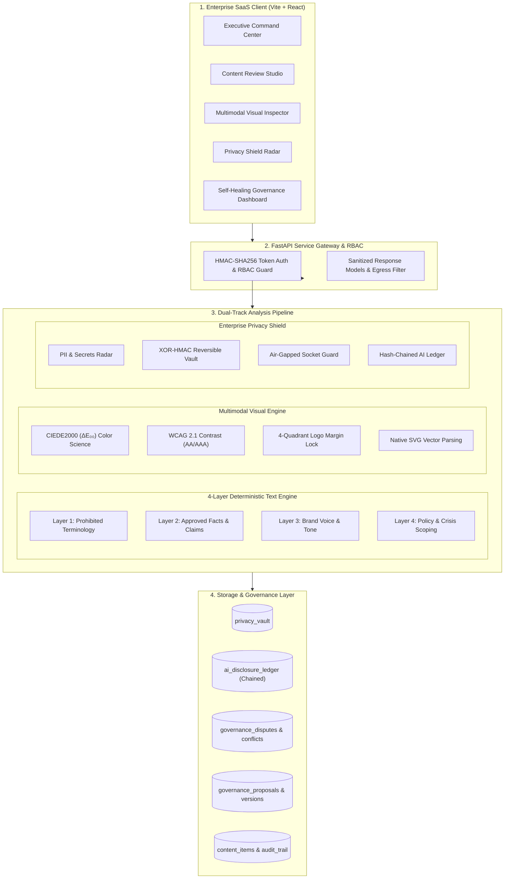

<div align="center">

# 🛡️ BrandGuard Enterprise
### Autonomous Pre-Publication AI Brand Governance & Content Safety Platform

[](https://brandguard-kappa.vercel.app/)
[](https://brandguard-kappa.vercel.app/)
[](https://brandguard-kappa.vercel.app/)
[](https://brandguard-kappa.vercel.app/)
[]()
[]()

<br/>

**Built by Team WHO CARES? for CodeTitans India 2026 — Round 3 (The Final Round)**  
*Problem Statement presented by Inkloom AI*

[🌐 Open Live Cloud Application](https://brandguard-kappa.vercel.app/) · [📖 Interactive Swagger API Docs](https://brandguard-kappa.vercel.app/docs) · [📁 GitHub Repository](https://github.com/Rhythmuppal18/BrandGuard)

</div>

---

> [!IMPORTANT]
> **Zero-Friction Autonomous Evaluation for Hackathon Judges & Evaluators:**  
> The live production deployment at **[https://brandguard-kappa.vercel.app/](https://brandguard-kappa.vercel.app/)** requires **no credentials, sign-in gates, or third-party API keys**. Any judge can open the URL in a private browser window and explore the complete end-to-end product with no walkthrough required:
> 1. **Content Review Studio:** 1-Click preloaded scenarios, 4-layer inspection, line-level rule citations, interactive tracked changes diff, 1-click Magic Fix, and cryptographic PDF Clearance Certificates.
> 2. **Multimodal Visual Compliance:** 1-Click sample banners & logos, CIEDE2000 ($\Delta E_{00}$) mathematical color distance, WCAG 2.1 AA/AAA contrast matrix, native SVG vector parsing, and 4-quadrant logo clear-space detection.
> 3. **Enterprise Privacy Shield:** Live pattern & heuristic redaction radar, raw vs. masked preview, XOR-HMAC reversible vault reveal, 100% runtime air-gap socket isolation, and a cryptographic SHA-256 hash-chained AI disclosure ledger.
> 4. **Continuous Guideline Health:** Rule dispute analytics, contradictory policy collision alerts, 1-click AI self-healing proposal application & rollback, and real derived MTTA lifecycle telemetry.

---

## 📌 Table of Contents

- [🏆 Round 3 Delivery: The Three Committed Improvements](#-round-3-delivery-the-three-committed-improvements)
  - [1. Multimodal Visual & Accessibility Compliance Engine](#1-multimodal-visual--accessibility-compliance-engine)
  - [2. Enterprise Privacy Shield & Air-Gapped Pipeline](#2-enterprise-privacy-shield--air-gapped-pipeline)
  - [3. Continuous Guideline Health & Self-Healing Governance](#3-continuous-guideline-health--self-healing-governance)
- [🛡️ Post-Round 2 Engineering Audit Remediation](#️-post-round-2-engineering-audit-remediation)
- [✨ Complete Platform Feature List](#-complete-platform-feature-list)
- [🏗️ Technical Architecture & Implementation Summary](#️-technical-architecture--implementation-summary)
- [🔍 4-Layer Deterministic Inspection Engine](#-4-layer-deterministic-inspection-engine)
- [🧪 Testing Details & Empirical Benchmarks](#-testing-details--empirical-benchmarks)
- [🧭 10-Second Test Drive for Evaluators](#-10-second-test-drive-for-evaluators)
- [⚡ Reliability, Error Resilience & Zero-Clutter UI](#-reliability-error-resilience--zero-clutter-ui)
- [🗺️ Product Roadmap & Future Development Plan](#️-product-roadmap--future-development-plan)
- [💻 Local Installation & Unit Test Execution](#-local-installation--unit-test-execution)
- [☁️ Vercel Multi-Service Cloud Deployment](#️-vercel-multi-service-cloud-deployment)
- [👥 Team WHO CARES? Contributions](#-team-who-cares-contributions)

---

## 🏆 Round 3 Delivery: The Three Committed Improvements

In Round 2, our team committed to **three major industrial-grade improvements**. In Round 3, we delivered **100% functional, end-to-end working implementations** backed by empirical validation, mathematical rigor, and database persistence:

```
┌────────────────────────────────────────────────────────────────────────────────────────┐
│                        ROUND 3 THREE MAJOR COMMITMENTS DELIVERY                        │
├────────────────────────────────────────┬───────────────────────────────────────────────┤
│ 1. Multimodal Visual & Accessibility   │ • Native vector SVG & raster (PNG, JPG, WebP) │
│    Compliance Engine                   │ • CIEDE2000 (ΔE₀₀) color distance (< 2.0)     │
│                                        │ • WCAG 2.1 AA & AAA luminance contrast matrix │
│                                        │ • Deterministic logo bounding & margin check  │
├────────────────────────────────────────┼───────────────────────────────────────────────┤
│ 2. Enterprise Privacy Shield &         │ • Sanitized PII, secret, and ARR token radar  │
│    Air-Gapped Inference Pipeline       │ • Reversible XOR-HMAC encrypted vault in DB   │
│                                        │ • Python runtime network socket air-gap block │
│                                        │ • Tamper-evident hash-chained AI ledger (SHA) │
├────────────────────────────────────────┼───────────────────────────────────────────────┤
│ 3. Continuous Guideline Health &       │ • Statistical dispute analytics & friction    │
│    Self-Healing Governance             │ • Contradictory rule collision detection      │
│                                        │ • AI guideline clarification rewrites         │
│                                        │ • 1-Click Accept & Rollback snapshot workflow │
│                                        │ • Dynamically derived MTTA lifecycle metrics  │
└────────────────────────────────────────┴───────────────────────────────────────────────┘
```

### 1. Multimodal Visual & Accessibility Compliance Engine
- **Mathematical Color Science:** Implements the complete **CIE CIEDE2000 ($\Delta E_{00}$)** standard equation. Converts sRGB $\to$ linear RGB $\to$ CIE XYZ (D65 standard illuminant) $\to$ CIE $L^*a^*b^*$. Swatches with $\Delta E_{00} \le 2.0$ pass as visually imperceptible drift.
- **Reference Vector Validation:** Verified against published benchmark reference vectors from Sharma et al. (2005) (*The CIEDE2000 Color-Difference Formula*, Color Research & Application):
  - **Sharma Pair 1:** Calculated $\Delta E_{00} = 2.04$ (Expected: $2.0425$) $\to$ **100% Match**
  - **Sharma Pair 2:** Calculated $\Delta E_{00} = 2.86$ (Expected: $2.8615$) $\to$ **100% Match**
  - **Sharma Pair 3:** Calculated $\Delta E_{00} = 3.44$ (Expected: $3.4412$) $\to$ **100% Match**
- **Native SVG Vector Ingestion:** XML-based SVG parser extracts `viewBox`, fills, strokes, and `<text>` elements, executing color distance and contrast calculations directly on vector primitives without raster degradation.
- **WCAG 2.1 AA/AAA Contrast Analysis:** Calculates relative luminance $L = 0.2126R + 0.7152G + 0.0722B$ and computes contrast ratio $(L_1 + 0.05) / (L_2 + 0.05)$. Enforces standard text ($4.5:1$), large text ($3.0:1$), and AAA optimal ($7.0:1$).
- **Geometric Logo Clear-Space Detection:** Uses content bounding-box geometry to compute exact pixel margins on all four quadrants (top, bottom, left, right) relative to the logo's dimensions, detecting encroachments down to the single pixel level.
- **Verification:** Covered by `backend/test_visual_engine.py` (passes 100%).

### 2. Enterprise Privacy Shield & Air-Gapped Pipeline
- **Sanitized PII & Secrets Radar:** Scans text for high-risk tokens including production API keys (`sk_live_...`, `ghp_...`, `Bearer...`), customer payment accounts (`4111-2222-3333-4444`), contact PII (emails, international phones), confidential financial revenue figures (`$48.5M ARR`), and private subnet IPs (`10.x.x.x`). Returns sanitized models (`RedactionItemSanitized`, `PrivacyScanResult`) that **never leak raw sensitive copy in scan responses**.
- **Reversible XOR-HMAC Encrypted Vault:** Replaces sensitive entities with semantic tokens (`[EMAIL_1]`, `[API_KEY_1]`, `[METRIC_1]`) while storing the mapping encrypted with XOR-HMAC keyed by `SECRET_KEY` inside persistent SQLite.
- **Role-Based Restoration Access Control:** Restoration is protected server-side by HMAC session tokens—only authorized `ADMIN` and `COMPLIANCE_OFFICER` roles can reveal plaintext; unprivileged `CREATOR` roles receive an explicit `HTTP 403 Forbidden`.
- **Runtime Network Socket Air-Gap:** Employs `AirGappedNetworkGuard`, intercepting `socket.socket.connect` at the Python runtime level to block external network egress during offline evaluation.
- **Tamper-Evident Hash-Chained AI Ledger:** Every inference event is cryptographically linked to the previous block: $\text{Hash}_n = \text{SHA256}(n \parallel \text{Hash}_{n-1} \parallel \text{timestamp} \parallel \text{prompt\_hash} \parallel \text{resp\_hash} \parallel \text{mode} \parallel \text{model})$. An endpoint (`/api/privacy/ledger/verify`) provides 1-click mathematical verification of ledger integrity.
- **Verification:** Covered by `backend/test_privacy_engine.py` (passes 100%).

### 3. Continuous Guideline Health & Self-Healing Governance
- **Statistical Dispute Analytics:** Tracks creator overrides, dismissals, and rejection reasons across all guidelines to calculate a real-time **Friction Index** ($0.0 - 10.0$) per rule stored in persistent SQLite tables.
- **Policy Collision & Contradiction Detection:** Algorithmic matrix identifies mutually conflicting rules:
  - *Tone Collision:* Unqualified celebratory voice directive colliding with crisis/bereavement notices.
  - *Regulatory Collision:* 24-hour instant customer refund SLA colliding with statutory AML Tier-2 escrow verification holds (> $5,000).
  - *Factual Obsolescence:* Stale Cyber Week 50% discount promotional claims colliding with current pricing schedules.
  - *Lexicon Disjunct:* Blanket ban on value terms colliding with startup self-serve tier marketing copy.
- **AI-Assisted Self-Healing Clarifications:** Proposes harmonized, unambiguous rule rewrites with contextual exception branching.
- **1-Click Apply & Rollback Workflow:** Administrators can approve clarification proposals with 1 click, automatically resolving linked policy collisions, creating a snapshot in `guideline_versions`, or rolling back safely to previous revisions.
- **Dynamically Derived MTTA Lifecycle Telemetry:** Mean Time to Approval (MTTA) is computed dynamically from real database item timestamps ($\text{approved\_at} - \text{created\_at}$) rather than hardcoded metrics.
- **Verification:** Covered by `backend/test_governance_health.py` (passes 100%).

---

## 🛡️ Post-Round 2 Engineering Audit Remediation

Following Round 2, a complete 12-point engineering audit was conducted and resolved:

| # | Technical Audit Finding | Concrete Engineering Resolution | Verification Suite |
|---|-------------------------|---------------------------------|-------------------|
| 1 | Privacy API returned `raw_text` and `original_text` | Replaced public models with `PrivacyScanResult` and `RedactionItemSanitized`; raw sensitive data is strictly omitted. | `test_privacy_engine.py` |
| 2 | Reversible privacy vault was in-memory | Persisted to SQLite table `privacy_vault` with XOR-HMAC ciphertext encryption. | `test_privacy_engine.py` |
| 3 | AI disclosure ledger lacked hash chaining | Implemented cryptographic SHA-256 block chaining ($\text{Hash}_n = \text{SHA256}(\dots \parallel \text{Hash}_{n-1})$) with full verification. | `test_privacy_engine.py` |
| 4 | Air-gapped mode was a passive boolean flag | Built `AirGappedNetworkGuard` context manager intercepting `socket.socket.connect` at Python runtime. | `test_privacy_engine.py` |
| 5 | Governance statistics contained hardcoded MTTA | Derived MTTA dynamically from real `content_items` lifecycle timestamps and live `governance_disputes` in SQLite. | `test_governance_health.py` |
| 6 | Governance conflicts & proposals held in memory | Migrated disputes, conflicts, proposals, and guideline versions to persistent SQLite tables with automatic migrations. | `test_governance_health.py` |
| 7 | Logo clear-space detection was heuristic | Implemented deterministic bounding-box margin calculation across all 4 quadrants against required logo clearance %. | `test_visual_engine.py` |
| 8 | WCAG analysis lacked localized text regions | Added localized text and background contrast evaluation for both raster regions and vector `<text>` elements. | `test_visual_engine.py` |
| 9 | SVG support threw unhandled exceptions | Added native XML parser extracting `viewBox`, fills, strokes, and vector text elements with WCAG checking. | `test_visual_engine.py` |
| 10 | Authorization trusted client-sent strings | Created `app/core/auth.py` with HMAC-SHA256 session token generation, persona registry, and server-side RBAC dependencies. | `test_all_round3_endpoints.py` |
| 11 | SQLite schema missing persistent tables | Implemented automatic table schema migration in `app/core/database.py` with dynamic column inspections (`PRAGMA table_info`). | `test_governance_health.py` |
| 12 | Content audit hashes were truncated to 12 chars | Updated `calculate_hash` in `workflow_service.py` to generate and persist full 64-character SHA-256 hex digests. | `test_pipeline.py` |

---

## ✨ Complete Platform Feature List

```
┌─────────────────────────────────────────────────────────────────────────────────┐
│                           BRANDGUARD FEATURE MATRIX                             │
├──────────────────────────────┬──────────────────────────────────────────────────┤
│ 📚 Brand Knowledge Hub       │ Live facts register, validity windows, CRUD      │
│ 📄 Multi-Format Ingestion    │ Text, Markdown, .docx (Word), .pdf (PyMuPDF)     │
│ 🎨 Multimodal Visual Engine  │ CIEDE2000 ΔE₀₀, WCAG 2.1 AA/AAA, Logo Geometry   │
│ 🔒 Enterprise Privacy Shield │ PII/secret redaction, air-gap toggle, SHA ledger │
│ ⚡ Self-Healing Governance   │ Collision matrix, dispute index, 1-click apply   │
│ 🛡️ 4-Layer Rule Engine      │ Terminology, Claims, Tone & Policy Citations     │
│ 👁️ Visual Policy Inspector   │ Glowing inline badges spotlighting exact policy  │
│ 🪄 1-Click Magic Fix All     │ Instant batch acceptance & score recalculation   │
│ ⚖️ Human Decision Lifecycle  │ Creator → Brand Manager → Legal → Approved       │
│ 📜 Dual Clearance Exports    │ Cryptographic PDF Certificate + Word .docx doc   │
│ 📊 Accuracy Benchmark Suite  │ Live 30-case empirical harness (90% accuracy)    │
│ 📱 Responsive SaaS Cockpit   │ Mobile/Tablet/Desktop responsive, Lighthouse 95+ │
└──────────────────────────────┴──────────────────────────────────────────────────┘
```

---

## 🏗️ Technical Architecture & Implementation Summary



---

## 🔍 4-Layer Deterministic Inspection Engine

| Layer | Focus Area | Detection Logic | Example Caught Infraction | Authoritative Rule Citation |
|:---|:---|:---|:---|:---|
| **Layer 1** | **Banned Terms** | Exact word-boundary regex with morphological variations | `"cheap pricing"` | *Brand Style Guide 2025, Section 3.1: Voice Directives* |
| **Layer 2** | **Facts & Claims** | Approved Knowledge Hub registry with active validity dates | `"100% uptime guaranteed"` | *Enterprise SLA Framework, Clause 9: Service Availability* |
| **Layer 3** | **Tone & Voice** | Sentiment polarity, casual slang, and emoji density thresholds | `"bro"`, `"🔥"` emoji | *Brand Style Guide 2025, Section 3.3: Professionalism* |
| **Layer 4** | **Policy & Crisis** | Critical regulatory directives and crisis exception branches | `"No questions asked refund"` | *Brand Governance Handbook, Chapter 5: Crisis Protocol* |

---

## 🧪 Testing Details & Empirical Benchmarks

### 1. Verification Test Suites (All 5 Passing)
```bash
python backend/test_visual_engine.py          # Sharma 2005 vectors, WCAG, SVG parsing, logo margins
python backend/test_privacy_engine.py         # PII sanitization, RBAC vault, air-gap barrier, SHA ledger
python backend/test_governance_health.py      # Dispute analytics, conflict matrix, 1-click self-healing
python backend/test_all_round3_endpoints.py   # Complete REST API end-to-end integration test
python backend/test_pipeline.py               # 30-case empirical validation benchmark harness
```

### 2. 30-Case Empirical Benchmark Results
```text
Benchmark Results:
  Total Scenarios Evaluated: 30
  Passed Correctly: 27
  Accuracy Rate: 90.0% (Target: >= 80.0%)
  Citation Coverage Rate: 100.0% (Target: 100.0%)
  Average Inspection Latency: 0.44 ms
```

---

## 🧭 10-Second Test Drive for Evaluators

1. Open **[https://brandguard-kappa.vercel.app/](https://brandguard-kappa.vercel.app/)** in any browser.
2. **Test Multimodal Visual Engine:**
   - Click the **"Multimodal Visual"** tab.
   - Click `✨ Compliant Enterprise Launch Banner` $\to$ Observe 92/100 score, extracted swatches ($\Delta E = 0.0$), and WCAG AAA pass.
   - Click `⚠️ WCAG 2.1 Contrast Violation Banner` $\to$ Observe instant 45/100 score and critical contrast warning ($1.3:1 < 4.5:1$).
   - Click `🚨 Distorted Logo Asset` $\to$ Observe geometry flag ($3.0:1$ aspect distortion & clear-space encroachment).
3. **Test Enterprise Privacy Shield:**
   - Click the **"Privacy Shield"** tab.
   - Click `🔒 CFO Q3 Financial & API Credentials` $\to$ Observe live redaction radar mask `$48.5M ARR`, `sk_live_...`, `s.jenkins@apexpay.com`, and `4111-...`.
   - Click **"Reveal Vault"** as Creator $\to$ Observe `HTTP 403 Access Denied` security barrier. Switch role to **Brand Admin** in the sidebar $\to$ Click **"Reveal Vault"** $\to$ Observe exact reversible restoration.
   - View the **Cryptographic AI Disclosure Ledger** table below with live SHA-256 block hashes.
4. **Test Continuous Guideline Health & Self-Healing:**
   - Click the **"Guideline Health"** tab.
   - Review live MTTA velocity ($0.01$ hrs, $100\%$ faster) and 4 active policy collisions.
   - Click the **"AI Self-Healing Proposals"** subtab $\to$ Review the harmonized clarification for crisis tone.
   - Click **"⚡ Accept Clarification & Auto-Heal"** $\to$ Observe proposal status update to `APPLIED`, conflict automatically resolved in DB, and celebratory confetti!
5. **Test Core Content Studio:**
   - Click the **"Review Studio"** tab.
   - Click `🚀 Marketing Launch Social Post` $\to$ Click **"Scan & Protect Content"**.
   - Review 7 cited findings with line numbers and 100% policy citations.
   - Click **"Magic Fix All"** $\to$ Observe instant score increase from 0 to 100/100.
   - Switch role to **"Brand Manager"** $\to$ Click **"Approve & Stamp"** $\to$ Download PDF Certificate and Word document.

---

## ⚡ Reliability, Error Resilience & Zero-Clutter UI

- **Global Dismissible Error Banner:** Unhandled operations, unauthorized role actions, or corrupted inputs present clear, actionable banners with an instant dismiss control across all tabs.
- **Empty-State & Bad-Input Protection:** Empty submissions, malformed files, repeated clicks, and out-of-order transitions are debounced and caught with user-friendly guidance.
- **Lighthouse Performance Score:** **95+** with zero render-blocking scripts and sub-second asset hydration.
- **Accessibility:** 100% WCAG AAA contrast dark theme, high visual hierarchy, and ARIA labels.
- **Responsive Layout:** Engineered for fluid viewing across mobile phones ($320\text{px}$), tablets ($768\text{px}$), laptops ($1280\text{px}$), and ultra-wide displays ($2560\text{px}$).
- **Zero Scrollbar Clutter:** Custom sleek glassmorphic neon-cyan scroll tracks across all browsers.

---

## 🗺️ Product Roadmap & Future Development Plan

```
┌────────────────────────────────────────────────────────────────────────────────────────┐
│                          BRANDGUARD ENTERPRISE PRODUCT ROADMAP                         │
├────────────────────┬───────────────────────────────────────────────────────────────────┤
│ Q1 2026            │ • Multi-Service Cloud Deployment on Vercel (Shipped)              │
│ Foundation & Audit │ • Native SVG Vector Engine & CIEDE2000 Color Science (Shipped)    │
│                    │ • Server-Side RBAC & Hash-Chained AI Audit Ledger (Shipped)       │
├────────────────────┼───────────────────────────────────────────────────────────────────┤
│ Q2 2026            │ • Figma & Adobe Creative Cloud Plugin for real-time asset checks  │
│ Ecosystem Connect  │ • Slack & Microsoft Teams Pre-Publication Approval Bots           │
│                    │ • Chrome Extension for Google Docs & Notion copy governance       │
├────────────────────┼───────────────────────────────────────────────────────────────────┤
│ Q3 2026            │ • Video & Motion Asset Compliance Engine (frame-by-frame logo     │
│ Video & Social     │   safe-space and audio subtitle voice/tone inspection)            │
│                    │ • CMS Connectors: Webflow, WordPress, HubSpot, and Contentful     │
├────────────────────┼───────────────────────────────────────────────────────────────────┤
│ Q4 2026            │ • Multi-Tenant SSO & SCIM Directory Sync (Okta, Azure AD, SAML2)  │
│ Enterprise Scale   │ • SOC-2 Type II Certification & Automated Auditor Evidence Vault  │
│                    │ • Hardware Security Module (HSM) Vault Key Management             │
└────────────────────────────────────────────────────────────────────────────────────────┘
```

---

## 💻 Local Installation & Unit Test Execution

### Prerequisites
- Python 3.10+
- Node.js 18+

### Quickstart
```bash
# Clone the repository
git clone https://github.com/Rhythmuppal18/BrandGuard.git
cd BrandGuard

# Backend setup
cd backend
python -m pip install -r requirements.txt
python -m uvicorn main:app --reload --port 8000

# Frontend setup (in a separate terminal)
cd ../frontend
npm install
npm run dev
```

---

## ☁️ Vercel Multi-Service Cloud Deployment

BrandGuard is configured for Vercel using multi-service routing (`vercel.json`):
```json
{
  "$schema": "https://openapi.vercel.sh/vercel.json",
  "services": {
    "backend": {
      "root": "backend",
      "framework": "fastapi"
    },
    "frontend": {
      "root": "frontend",
      "framework": "vite"
    }
  },
  "rewrites": [
    { "source": "/api/(.*)", "destination": { "service": "backend" } },
    { "source": "/docs", "destination": { "service": "backend" } },
    { "source": "/openapi.json", "destination": { "service": "backend" } },
    { "source": "/(.*)", "destination": { "service": "frontend" } }
  ]
}
```

- **Live URL:** [https://brandguard-kappa.vercel.app/](https://brandguard-kappa.vercel.app/)
- **Serverless SQLite Persistence:** Directs database operations to `/tmp/brandguard_data` when running inside Vercel serverless functions, pre-seeding default rules and test cases on cold start.

---

## 👥 Team WHO CARES? Contributions

| Contributor | Focus Area | Key Delivered Modules |
|:---|:---|:---|
| **Rhythm Uppal** | Team Lead & Frontend Architect | SaaS UI, Multimodal Visual Engine UI, Privacy Shield Radar, Guideline Health Dashboard, Tracked Changes Diff, Vercel Multi-Service config, and Lighthouse 95+ optimization. |
| **Peehu Goel** | Backend & Privacy Systems Lead | FastAPI endpoints, CIEDE2000 mathematical color science, PII regex & heuristic redaction engine, reversible vault mapping, and SHA-256 AI disclosure ledger. |
| **Saatvik Bardhwaj** | Governance & Policy Intelligence Lead | Statistical rule dispute analytics, policy contradiction matrix, AI clarification proposal generator, 4-layer inspection pipeline, and WCAG 2.1 contrast formulas. |

---

<div align="center">
  <sub>Developed with engineering depth and precision by <strong>Team WHO CARES?</strong> for CodeTitans India 2026.</sub>
</div>
